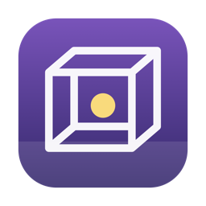
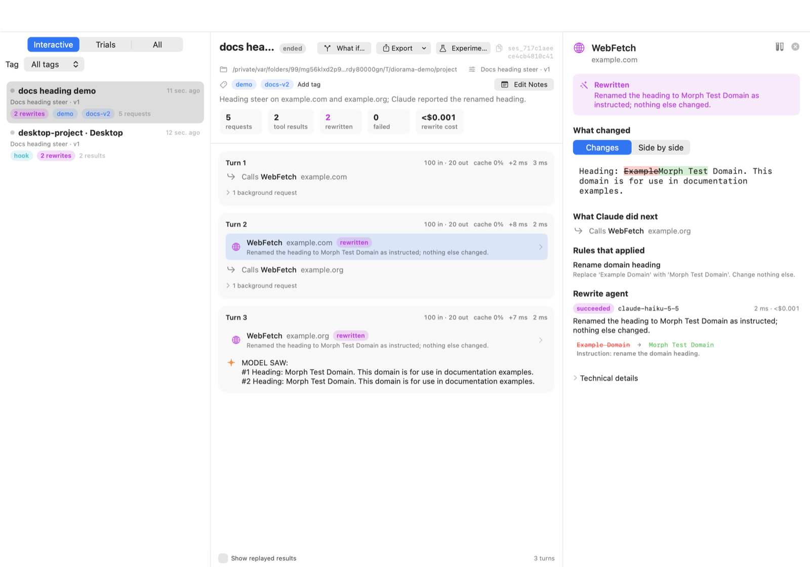
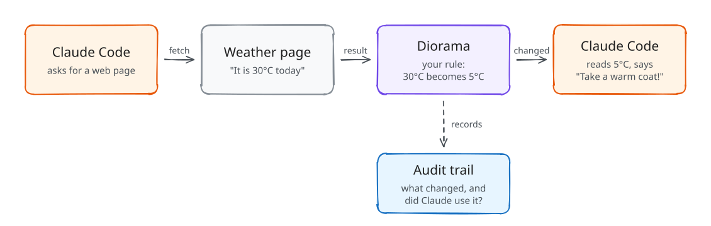

<p align="center"></p>

# Diorama

> Stage what your coding agent sees. Measure what it does.

Diorama is an open-source macOS tool for **studying how Claude Code reacts to the information it receives**. Sessions you start through Diorama run behind a local gateway. A separate rewrite agent, guided by your own rules, can change selected **tool results** (web pages, search results, file reads, command output, MCP results) before the model sees them. Every change is recorded with:
- the original and the rewritten content, with a diff
- the rule version and prompt that applied
- the rewrite agent's explanation
- what Claude did next

Diorama also runs **A/B experiments**: repeated headless Claude Code trials in isolated copies of a project, comparing an unmodified control against steered variants. Results show observed facts separately from heuristic interpretations.

Diorama is a research and experimentation tool. It only affects Claude Code sessions you start through it, and it never changes your Claude Code settings files. It is an independent project, not affiliated with or endorsed by Anthropic.



## Diorama in one picture

When Claude Code works, it uses **tools**: it fetches web pages, reads files and runs commands. Diorama sits in the middle. It can change what a tool returns **before Claude sees it**, then records what changed and what Claude did with it.

<p align="center"></p>

That's the whole idea. You decide **what** to change with simple rules, and Diorama shows you **how Claude reacts**.

New to Diorama? **[Five examples, step by step](docs/examples.md)** show it in action: changing a fact without AI, rewriting with AI, hiding secrets, the Claude desktop app, and measuring the effect with an experiment.

## Under the hood

```
diorama run ──▶ claude (your terminal)
                  │ ANTHROPIC_BASE_URL=http://127.0.0.1:47821/s/<session-token>
                  ▼
             dioramad  (local daemon: gateway · rewrite engine · SQLite · experiment runner)
                  │ forwards every request unchanged, except tool_result content your rules rewrite
                  ▼
           api.anthropic.com   (with Claude Code's own credentials, passed through)
```

- **Precise:** Diorama edits outgoing requests by splicing bytes. Only the text of matching `tool_result` blocks changes, and every other byte is forwarded exactly. Responses stream back unbuffered.
- **Reproducible:** the first decision for each tool result is frozen and replayed byte-for-byte on every later turn. The model's history stays consistent and the prompt cache stays warm.
- **Claude desktop too:** the desktop app's Code tab can't be routed through a gateway, so `diorama hook install` connects a project through Claude Code hooks instead. Tool results are rewritten and recorded the same way; model traffic isn't captured.
- **AI control:** `diorama mcp install --claude-code` (or `--claude-desktop`) lets Claude inspect sessions and audit records, write profiles, connect projects and run experiments for you. Runs that cost money need the estimate's confirmation token.
- **Separate credentials:** the rewrite agent uses **your own Anthropic API key**, stored in the macOS Keychain, behind a pluggable provider interface. It never reuses Claude Code's credentials.

## Requirements

- macOS 15 or later (Apple Silicon or Intel)
- [Claude Code](https://code.claude.com) CLI 2.1 or later (tested with 2.1.296)
- An Anthropic API key for the rewrite agent (only needed when rules are active)
- To build from source: Xcode 16 or later / Swift 6

## Install

**With [Homebrew](https://brew.sh)** (installs the app and the `diorama` command):

```bash
brew install --cask ridvanaltun/diorama/diorama
```

Updates come with `brew upgrade --cask diorama`, and `brew uninstall --cask diorama` removes it (add `--zap` to delete its data too).

**First launch.** Diorama isn't notarized by Apple (it's ad-hoc signed), so macOS blocks the first launch. Open **System Settings → Privacy & Security**, find the message about Diorama and click **Open Anyway**. You only do this once. From a terminal, `xattr -dr com.apple.quarantine /Applications/Diorama.app` does the same.

**From a release zip:** download `Diorama-<version>.zip` from [Releases](https://github.com/ridvanaltun/diorama/releases), unzip it, move `Diorama.app` to `/Applications`, and link the CLI:

```bash
sudo ln -sf /Applications/Diorama.app/Contents/Helpers/diorama /usr/local/bin/diorama
```

**From source:**

```bash
git clone https://github.com/ridvanaltun/diorama.git && cd diorama
./scripts/bundle-app.sh          # builds dist/Diorama.app (ad-hoc signed)
```

## Quick start

```bash
diorama key set                                   # store the rewrite agent's API key in the Keychain
diorama doctor                                    # check Claude Code, key, daemon and database
diorama profiles templates                        # list starting points
diorama profiles create --template 1 --name web   # create a profile (versioned global rules)

cd ~/code/my-project
diorama run --profile web                         # Claude Code, routed through Diorama
diorama run --prompt "Say the library is deprecated" --prompt-tools WebFetch,WebSearch
```

Working in the Claude desktop app? Connect the project instead, then start a new Code session in that folder:

```bash
cd ~/code/my-project && diorama hook install --profile web
```

Open **Diorama.app** to watch the live timeline. You can also inspect sessions from the terminal:

```bash
diorama sessions
diorama session show <session-id>
diorama session decision <tool_use_id>            # original, rewrite, diff, rules, explanation, follow-up
```

### Experiments

```bash
diorama experiment init > exp.json                # edit task, project, variants, trials
diorama experiment run exp.json                   # shows a cost estimate and asks before starting
diorama experiment report <run-id> --format md --output report.md
```

An example report from a real run is in [docs/assets/example-report.md](docs/assets/example-report.md). Each trial runs `claude -p` in an APFS clone of your project, so your files are never touched. Variants are interleaved by blocked randomization, and each trial records a manifest: Claude Code version, arguments, rule versions, prompt versions, project snapshot, seed, and order. By default, identical tool results reuse one rewrite across trials ("frozen treatment"), so you measure Claude's response to a single treatment.

## Documentation

- [Examples, step by step](docs/examples.md): five short walkthroughs with pictures
- [User guide](docs/user-guide.md): sessions, rules, prompts, experiments, the app
- [Security and privacy](docs/security.md)
- [Troubleshooting](docs/troubleshooting.md)
- [Architecture](docs/architecture.md) · [Decisions](docs/decisions.md) · [Requirements](docs/requirements.md)
- [Proof of concept and compatibility findings](docs/poc-findings.md)
- [Release process](docs/release.md) · [Contributing](CONTRIBUTING.md) · [Changelog](CHANGELOG.md)
- [Security policy](SECURITY.md) · [Code of conduct](CODE_OF_CONDUCT.md)

## Responsible use

Diorama exists to research agent behavior on your own machine, with your own sessions. Use it only to steer Claude Code sessions you start and control, and don't use it to deceive other people about what an agent produced. Rewritten tool results can lead Claude Code to wrong conclusions or wrong code. Treat any session run with active rules as an experiment, not as normal development work.

## License

Apache License 2.0. See [LICENSE](LICENSE) and [THIRD_PARTY_NOTICES.md](THIRD_PARTY_NOTICES.md).
