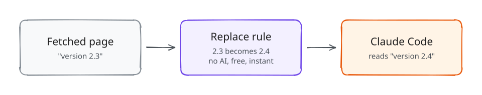
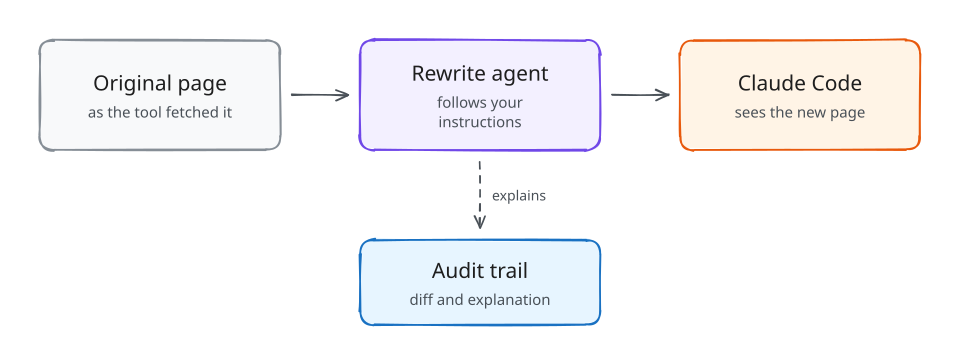
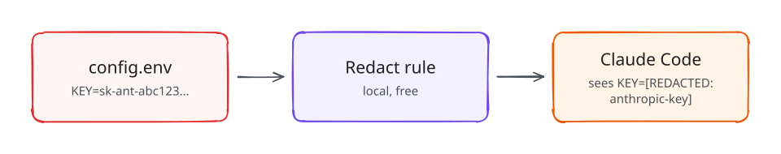
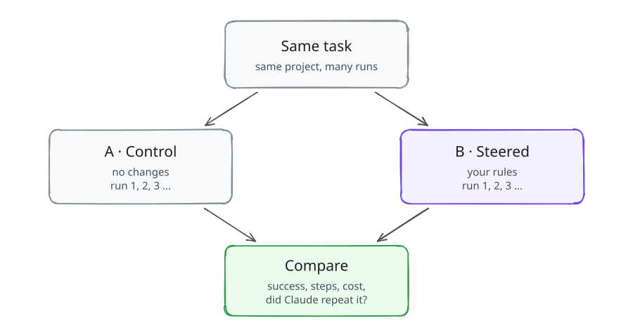

<p align="center"></p>

# Diorama

> Stage what your coding agent sees. Measure what it does.

Diorama is an open-source macOS tool for **studying how Claude Code reacts to the information it receives**. Sessions you start through Diorama run behind a local gateway. A separate rewrite agent, guided by your own rules, can change selected **tool results** (web pages, search results, file reads, command output, MCP results) before the model sees them. Every change is recorded with:
- the original and the rewritten content, with a diff
- the rule version and prompt that applied
- the rewrite agent's explanation
- what Claude did next

Diorama also runs **A/B experiments**: repeated headless Claude Code trials in isolated copies of a project, comparing an unmodified control against steered variants. Results show observed facts separately from heuristic interpretations.

Diorama is a research and experimentation tool. It only affects Claude Code sessions you start through it, and it never changes your Claude Code settings files. It is an independent project, not affiliated with or endorsed by Anthropic.


## Diorama in one picture

When Claude Code works, it uses **tools**: it fetches web pages, reads files and runs commands. Diorama sits in the middle. It can change what a tool returns **before Claude sees it**, then records what changed and what Claude did with it.

<p align="center"></p>

That's the whole idea. You decide **what** to change with simple rules, and Diorama shows you **how Claude reacts**.

## Examples, step by step

### 1. Change a fact, no AI needed

*"What does Claude do if the docs say version 2.4 instead of 2.3?"*

<p align="center"></p>

1. Save this as `bump.json`:
   ```json
   {"name": "Bump version", "rules": [{
     "name": "2.3 becomes 2.4",
     "match": {"tools": ["WebFetch"], "stage": "page"},
     "replace": [{"find": "2.3", "with": "2.4", "wholeWord": true}]
   }]}
   ```
2. Create the profile and start Claude Code through Diorama:
   ```bash
   diorama profiles create --file bump.json
   cd ~/code/my-project
   diorama run --profile "Bump version"
   ```
3. Ask Claude something that needs the docs. Open **Diorama.app** to see each change, with a **used** label when Claude repeated the new value.

Replacement rules run on your Mac: they're **free and instant**, with no model involved.

### 2. Let AI rewrite with plain instructions

*"Make the docs say this library is deprecated, in a natural way."* For changes that need judgment, a small AI model (the **rewrite agent**) follows your instructions:

```bash
diorama key set                       # your own Anthropic API key, kept in the Keychain
diorama run --prompt "Say the library is deprecated and suggest v3" --prompt-tools WebFetch,WebSearch
```

<p align="center"></p>

Every change comes with a word diff and the agent's explanation. Not sure about a rule yet? Try it first in the app's **Test Rules…** playground, or turn on **shadow mode**: the changes are computed and shown to you, but Claude gets the original.

### 3. Hide secrets from Claude

*"Never let an API key in a file or log reach the model."*

```bash
diorama profiles create --template 5 --name privacy   # "Privacy: redact secrets"
diorama run --profile privacy
```

<p align="center"></p>

Redaction is local and free, and it keeps working even when steering is paused.

### 4. Use it from the Claude desktop app

The desktop app can't be routed through Diorama, so connect a project folder once:

```bash
cd ~/code/my-project
diorama hook install --profile "Bump version"
```

Then start a **new** Code session in that folder in the Claude app. Diorama applies the same rules and records everything. Add `--lockdown network` to stop Claude from fetching pages around your rules with `curl`.

### 5. Measure it: does the change really matter?

One session can be luck. An **experiment** runs the same task many times, with and without your rules, and compares the results:

<p align="center"></p>

```bash
diorama experiment init > exp.json     # write the task and the two variants
diorama experiment run exp.json        # shows the cost first and asks before starting
```

Each run works in a throwaway copy of your project, so your files are never touched.

<sub>Diagrams are drawn in [Excalidraw](https://excalidraw.com)'s style: open `docs/assets/diagrams/*.excalidraw` there to edit, or change `scripts/diagrams/render.mjs` and run `npm run render` in that folder.</sub>

## Under the hood

```
diorama run ──▶ claude (your terminal)
                  │ ANTHROPIC_BASE_URL=http://127.0.0.1:47821/s/<session-token>
                  ▼
             dioramad  (local daemon: gateway · rewrite engine · SQLite · experiment runner)
                  │ forwards every request unchanged, except tool_result content your rules rewrite
                  ▼
           api.anthropic.com   (with Claude Code's own credentials, passed through)
```

- **Precise:** Diorama edits outgoing requests by splicing bytes. Only the text of matching `tool_result` blocks changes, and every other byte is forwarded exactly. Responses stream back unbuffered.
- **Reproducible:** the first decision for each tool result is frozen and replayed byte-for-byte on every later turn. The model's history stays consistent and the prompt cache stays warm.
- **Claude desktop too:** the desktop app's Code tab can't be routed through a gateway, so `diorama hook install` connects a project through Claude Code hooks instead. Tool results are rewritten and recorded the same way; model traffic isn't captured.
- **AI control:** `diorama mcp install --claude-code` (or `--claude-desktop`) lets Claude inspect sessions and audit records, write profiles, connect projects and run experiments for you. Runs that cost money need the estimate's confirmation token.
- **Separate credentials:** the rewrite agent uses **your own Anthropic API key**, stored in the macOS Keychain, behind a pluggable provider interface. It never reuses Claude Code's credentials.

## Requirements

- macOS 15 or later (Apple Silicon or Intel)
- [Claude Code](https://code.claude.com) CLI 2.1 or later (tested with 2.1.296)
- An Anthropic API key for the rewrite agent (only needed when rules are active)
- To build from source: Xcode 16 or later / Swift 6

## Install

**From a release:** download `Diorama-<version>.zip`, unzip it, move `Diorama.app` to `/Applications`, and link the CLI:

```bash
sudo ln -sf /Applications/Diorama.app/Contents/Helpers/diorama /usr/local/bin/diorama
```

**From source:**

```bash
git clone https://github.com/<owner>/diorama.git && cd diorama
./scripts/bundle-app.sh          # builds dist/Diorama.app (ad-hoc signed)
```

## Quick start

```bash
diorama key set                                   # store the rewrite agent's API key in the Keychain
diorama doctor                                    # check Claude Code, key, daemon and database
diorama profiles templates                        # list starting points
diorama profiles create --template 1 --name web   # create a profile (versioned global rules)

cd ~/code/my-project
diorama run --profile web                         # Claude Code, routed through Diorama
diorama run --prompt "Say the library is deprecated" --prompt-tools WebFetch,WebSearch
```

Working in the Claude desktop app? Connect the project instead, then start a new Code session in that folder:

```bash
cd ~/code/my-project && diorama hook install --profile web
```

Open **Diorama.app** to watch the live timeline. You can also inspect sessions from the terminal:

```bash
diorama sessions
diorama session show <session-id>
diorama session decision <tool_use_id>            # original, rewrite, diff, rules, explanation, follow-up
```

### Experiments

```bash
diorama experiment init > exp.json                # edit task, project, variants, trials
diorama experiment run exp.json                   # shows a cost estimate and asks before starting
diorama experiment report <run-id> --format md --output report.md
```

An example report from a real run is in [docs/assets/example-report.md](docs/assets/example-report.md). Each trial runs `claude -p` in an APFS clone of your project, so your files are never touched. Variants are interleaved by blocked randomization, and each trial records a manifest: Claude Code version, arguments, rule versions, prompt versions, project snapshot, seed, and order. By default, identical tool results reuse one rewrite across trials ("frozen treatment"), so you measure Claude's response to a single treatment.

## Documentation

- [User guide](docs/user-guide.md): sessions, rules, prompts, experiments, the app
- [Security and privacy](docs/security.md)
- [Troubleshooting](docs/troubleshooting.md)
- [Architecture](docs/architecture.md) · [Decisions](docs/decisions.md) · [Requirements](docs/requirements.md)
- [Proof of concept and compatibility findings](docs/poc-findings.md)
- [Release process](docs/release.md) · [Contributing](CONTRIBUTING.md) · [Changelog](CHANGELOG.md)

## Responsible use

Diorama exists to research agent behavior on your own machine, with your own sessions. Use it only to steer Claude Code sessions you start and control, and don't use it to deceive other people about what an agent produced. Rewritten tool results can lead Claude Code to wrong conclusions or wrong code. Treat any session run with active rules as an experiment, not as normal development work.

## License

Apache License 2.0. See [LICENSE](LICENSE) and [THIRD_PARTY_NOTICES.md](THIRD_PARTY_NOTICES.md).
