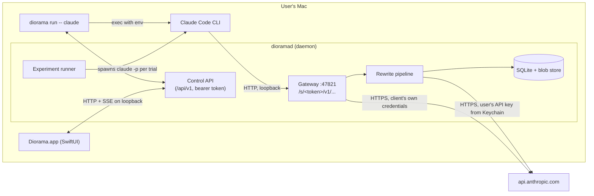

# Diorama — Architecture

This document covers the system design behind [requirements.md](requirements.md). Individual decisions and the reasons for them are recorded in [decisions.md](decisions.md). The evidence behind the core approach is in [poc-findings.md](poc-findings.md).

## 1. Big picture



Three executables are built from one Swift package:

| Executable | Role |
|---|---|
| `dioramad` | A long-running daemon that owns the gateway, the rewrite pipeline, the store, the experiment runner and the control API. The CLI and the app start it on demand as a detached process (`posix_spawn` with `POSIX_SPAWN_SETSID`). Starting it at login is opt-in with `diorama daemon install`, which writes a LaunchAgent. |
| `diorama` | The CLI. Its commands are `run`, `sessions`, `doctor`, `daemon start/stop/status`, and later `experiment run`. |
| `Diorama.app` | The SwiftUI client. It holds no state of its own and reads everything through the control API. If it crashes, running sessions are not affected. |

The daemon is separate from the GUI so that sessions keep working when the window is closed or the app crashes, and so that `diorama run` works in a terminal without the GUI.

## 2. Swift package layout

```
Package.swift
Sources/
  DioramaJSON/        byte-offset JSON index + splice editor + JSONValue (no Foundation JSON round-trip)
  DioramaCore/        shared models and control-API types, paths, hashing, pricing, glob, diff, statistics
  DioramaStore/       SQLite wrapper (system libsqlite3), migrations + recovery, blob store, repositories
  DioramaEngine/      request scan, rules/matcher, RewriteProvider (Anthropic, scripted), edit application,
                      secret stores (Keychain/env), DecisionEngine (frozen decisions, replay, treatments)
  DioramaGateway/     SwiftNIO HTTP server, URLSession streaming upstream, SSE observer, gateway handler,
                      control API, daemon composition
  DioramaRunner/      experiment runner, APFS clone, trial processes, analysis/heuristics, comparison, reports
  DioramaClient/      typed control-API client + daemon launcher (shared by CLI and app)
  dioramad/           daemon entry point
  diorama/            CLI (swift-argument-parser)
  DioramaApp/         SwiftUI app (SwiftPM executable; bundled by scripts/bundle-app.sh)
Tests/                JSON, engine, gateway (mock upstream), runner/store, contract (real `claude` CLI)
scripts/              bundle-app.sh, make-icon.swift, demo-screenshots.sh
spikes/               throwaway PoC code, kept as reference
```

There are only two external dependencies: `swift-nio` for the server and `swift-argument-parser` for the CLI. The upstream client is URLSession, storage is the system SQLite, hashing is CryptoKit, compression is Apple's Compression framework, and tests use Swift Testing. The app bundle places the GUI at `Contents/MacOS/Diorama` and the daemon and CLI at `Contents/Helpers/`. On a case-insensitive volume, `MacOS/diorama` would overwrite `MacOS/Diorama`.

There is no official Anthropic SDK for Swift. The rewrite provider therefore calls the Messages API over raw HTTPS through a small, typed client.

## 3. Session lifecycle

1. `diorama run [--profile P] [--prompt-file F] [--name N] [--lockdown web-only] -- claude <args>`
2. The CLI reads `daemon.json` and checks the control API. If the daemon isn't reachable, it starts `dioramad` and waits for it.
3. `POST /sessions` returns `{sessionId, token, baseURL}`. The session is persisted with a **frozen** configuration: the profile version, the session-prompt version and the lockdown set.
4. The CLI starts `claude` as a child process in the foreground (`posix_spawn`, with default signal handling restored), so Claude Code owns the terminal. Meanwhile the CLI acts as a **supervisor**: it forwards SIGTERM and SIGHUP, and if the daemon stops answering it restarts the daemon on the same port. The child keeps the user's environment, plus:
   - `ANTHROPIC_BASE_URL=http://127.0.0.1:47821/s/<token>`. The proof of concept confirmed that Claude Code keeps the path prefix.
   - `CLAUDE_CODE_GATEWAY_HINT_HEADERS=1`, which makes Claude Code label each request as main, subagent, auxiliary, compaction and so on.
   - `--settings '{"env":{...}}'` with the same variables, so that an `env` block in the user's `~/.claude/settings.json` can't silently override them. A contract test verifies this.
   - With lockdown on, `"permissions":{"deny":["Bash(curl:*)",…]}` in the same `--settings` JSON. A contract test verifies that Claude Code refuses the call with an `is_error` tool result.
5. The app's **New Session** button runs the same command in Terminal.app through a temporary `.command` file, and also offers *Copy command*.

`diorama doctor` checks: the Claude Code version against the tested range, settings that override `ANTHROPIC_BASE_URL`, daemon health, port availability, whether an API key is in the Keychain, and connectivity to the API.

## 4. Gateway

The gateway uses SwiftNIO HTTP/1.1 (NIOAsyncChannel) on `127.0.0.1` only. Port 47821 is the default; if it's busy the daemon tries the next 20 ports, and `--exact-port` disables that.

**Routing**
- `/s/{token}/…` looks up the session and strips the prefix before forwarding.
- An unknown token gets a `403` with an Anthropic-style error body and `x-should-retry: false`. Without that header Claude Code retries; the proof of concept saw 9 retries on a 401.
- Requests carrying an `Origin` header, or a `Host` other than a loopback name, are rejected. This protects against DNS rebinding and browser-originated requests.

**Forwarding**
- The request goes upstream to `https://api.anthropic.com` through a delegate-based URLSession: HTTP/2, TLS and the system proxy settings, with no cookies, cache or redirects. Body chunks are relayed as they arrive. `accept-encoding: identity` is sent upstream, and length and encoding headers are dropped from the response, because NIO re-frames the body.
- Every header is forwarded except hop-by-hop headers and `host`. `content-length` is recalculated only when the body changed.
- `Authorization`, `x-api-key` and `cookie` are never logged or persisted.

**Request pipeline**, for POST `/v1/messages` and `/v1/messages/count_tokens`:
1. The full body is buffered, with a configurable cap of 128 MB by default. Any `content-encoding` is decoded. Claude Code didn't compress bodies sent to a custom base URL in the proof of concept, but the gateway handles it anyway.
2. `DioramaJSON.scan` makes one pass and returns the `tool_use` map (`id → name, input`), every `tool_result` span (message and block index, `tool_use_id`, the byte range of the `content` value, the decoded content, `is_error`), plus request metadata such as model, stream flag and message count.
3. Each `tool_result` goes through the decision cache (§5).
4. If nothing changed, the **original bytes** are forwarded. Otherwise `DioramaJSON.splice` replaces only the affected byte ranges, and the encoding of every other byte is preserved.
5. All decision records are committed before anything is forwarded, as required by FR-19.

**Response path**
- Upstream bytes are written to the client as they arrive.
- A copy of the stream goes to an incremental SSE parser that extracts assistant text, `tool_use` blocks, `stop_reason`, usage figures and errors for the timeline. The parser never blocks delivery: it uses a bounded queue, and if the queue overflows the capture is marked incomplete.
- Response headers are forwarded verbatim.

**Other paths**, such as `HEAD /api/hello` and `GET /v1/models`, pass through transparently.

## 5. Decision cache and replay (the core invariant)

**Invariant: once Diorama has decided what Claude sees for a given `tool_use_id`, every later request carries exactly those bytes.**

```
DecisionRecord
  toolUseId        (globally unique, e.g. toolu_…)  — primary key
  originalHash     sha256 of original content bytes as sent by Claude Code
  outcome          unchanged | rewritten | failed
  replacementJSON  exact JSON bytes spliced in (rewritten only)
  ruleVersionIds   rules that contributed
  rewriteId        → RewriteAttempt (prompt, model, usage, latency, explanation, changes, raw response)
  sessionId, firstSeenRequestId, createdAt
```

How each case is handled:

| Situation | Behavior |
|---|---|
| No record yet | Evaluate the rules. If none match, record `unchanged`. If some match, run the rewrite (deduplicated per `toolUseId`, so simultaneous requests share one call), then record and splice. |
| Record exists, same `originalHash` | Replay the stored bytes exactly. This happens on every subsequent turn. |
| Record exists, different `originalHash` | Claude Code itself changed the content, for example by clearing old tool results. Forward what Claude Code sent and log a `client-modified` anomaly. |
| A rule is edited mid-session | No effect on existing records (FR-20). New tool results use the session's frozen profile version. |
| Session resumed outside Diorama | Can't be prevented. The timeline marks the session, and `doctor` explains the consequence: Claude sees the originals, and accounts subject to preserved-thinking enforcement may get history-mismatch errors or lose their thinking blocks. |

Records are keyed by `toolUseId` across all sessions. Resumed sessions, forks and subagents therefore stay consistent whenever they route through Diorama.

**Why this matters.** The proof of concept showed that an unstable rewrite doesn't produce an error. It quietly shows the model the original version on later turns, which corrupts the experiment. It also showed that stable replay keeps the prompt cache warm, and that the API accepts rewritten history alongside thinking blocks.

Preserved-thinking enforcement for accounts created on or after 2026-08-31 makes this more important: edited history can be rejected. Because replay always resends what the model actually saw, the history is consistent from the model's point of view.

**Experiment treatment cache.** For experiments the frozen-treatment default (FR-29) adds one more lookup before the rewrite agent is called. The key is `(variantId, ruleSetHash, toolName, canonicalInputHash, originalHash)`, and a hit reuses the stored rewrite. Every trial therefore sees the same treatment even though its `tool_use_id`s differ.

## 6. Rules and the rewrite agent

**Data model**
```
Profile(version)    name, ordered [RuleVersion], defaults {model, effort, onFailure, maxInputChars}
Rule(version)       name, enabled,
                    match { tools: ["WebFetch","mcp__docs__*"], input: {url: /docs\.example\.com/},
                            content: /regex/?, minChars?, maxChars?, requestClasses: [main, subagent] },
                    instructions (text), model?, effort?, context: none | task
SessionPrompt       an ad-hoc rule attached to one session (default match: WebFetch, WebSearch), applied last
```

Versions are immutable and content-hashed. Editing a rule creates a new version. Profiles can be exported and imported as JSON.

**Evaluation**
- Rules are matched deterministically, in order.
- If any rules match, **one** rewrite call is made per tool result, with each matching rule's instructions in priority order and the session prompt last.
- The audit records which rules contributed.

**The rewrite call** (`AnthropicProvider`)
- `POST /v1/messages` using the user's API key from the Keychain.
- The model comes from the rule, or else the profile, or else the global default (`claude-haiku-5-5`).
- A fixed, **versioned** Diorama system prompt (`rewrite-v1`) describes the task: rewrite as instructed, keep the format natural, add no markers, and leave text unchanged unless the instructions call for a change.
- The user message carries the tool name and input, the original content (text blocks only; images are preserved and not rewritten), the instructions, and the task context if the rule opted in.
- `output_config.format` takes a JSON schema:
  `{decision: "unchanged"|"edit"|"replace", edits: [{find, replace, rationale}], content: string, explanation: string}`.
  Edits are applied deterministically. Each `find` must occur exactly once, and edits must not overlap. When they don't apply, the request is retried once with the error included. "replace" swaps in full content, placed in the first text segment. Only the text segments of a result are spliced, so image blocks pass through untouched.
- Sampling settings aren't sent: the API now rejects `temperature`. Reproducibility comes from the decision cache, not from deterministic sampling.
- A `refusal` stop reason is recorded with its category and treated as a failure. A `max_tokens` stop reason is also a failure.
- For Opus 5.5 and Sonnet 5.5 the call sends the server-side `fallbacks: "default"` option, and the model that actually served the request is recorded.
- The request's token usage is converted to cost with a bundled pricing table, which is dated and can be edited.

**Timeouts and failures**
- One retry on 429, 5xx or network errors.
- 45 seconds per rewrite and a 120-second overall budget per request.
- `onFailure` is `passOriginal` (the default for interactive sessions, with the session flagged) or `invalidateTrial` (the default for experiments).
- Failures are frozen like any other decision.

**Provider interface**
```swift
protocol RewriteProvider: Sendable {
  var id: String { get }
  func rewrite(_ request: RewriteRequest) async throws -> RewriteResult   // RewriteResult carries usage + raw response
}
```

## 7. Storage

- SQLite (the system libsqlite3 behind a thin, locked wrapper) in WAL mode, at `~/Library/Application Support/Diorama/diorama.sqlite`. The schema version is kept in `PRAGMA user_version`. A database that fails `PRAGMA quick_check` is moved aside and recreated, and a schema newer than the binary is refused. The tables are `sessions`, `exchanges` (one per HTTP request), `tool_results`, `decisions`, `rewrite_attempts`, `profiles`, `rule_versions`, `experiments`, `variants`, `trials` and `events`.
- A content-addressed blob store sits beside the database at `blobs/ab/cdef…`, keyed by sha256 and compressed with LZFSE. It holds raw request and response bodies, original and rewritten contents, and trial transcripts. Identical content is stored once.
- Retention: full raw capture is on by default and kept for 14 days, with a size cap. Decisions, rewrites and experiment data are kept until the user deletes them.
- The control API (`/api/v1/…` on the same loopback port, bearer token from `daemon.json`) exposes queries plus a live event stream (SSE) for timelines.

## 8. Timeline model

- Each `exchange` stores the request class and agent ID from the hint headers, the model, the status, time to first byte, the latency Diorama added, and usage (input, output, cache reads, cache writes).
- Assistant `tool_use` blocks parsed from response N are linked to the `tool_result`s in request N+1. Those are linked to their decision records. The decisions are linked to the assistant turn that followed, which shows what Claude did next.
- Auxiliary requests, such as WebFetch's extraction call, appear grouped under the tool call that caused them.

## 9. Experiment runner (Phase 6+)

**Definition**: a versioned JSON document containing:
- the task prompt and project folder
- Claude Code options: model, permission mode, allowed and blocked tools, maximum turns, `--max-budget-usd`, and whether to isolate settings and MCP configuration
- the variants: control (no profile) plus one or more treatments, each a profile version with an optional prompt
- trials per variant, concurrency (default 2), and treatment mode (frozen or fresh)

**Trial execution**
1. Clone the project with `clonefile(2)` (an APFS copy-on-write clone, nearly instant) into `runs/<experiment>/<trial>/`, falling back to a recursive copy on other file systems.
2. Create a Diorama session for the variant.
3. Run `claude -p "<task>" --output-format stream-json --verbose --no-session-persistence --session-id <uuid> …` with the clone as the working directory and the gateway environment set.
4. Variants are interleaved by **blocked randomization**: each round contains every variant once, in seeded random order. Drift over time, such as API load or caches, therefore can't line up with one variant. The clone is deleted after analysis; `stdout.jsonl` and `stderr.txt` are kept under `runs/`.

**Manifest** (FR-30): the output of `claude --version`, the full argument vector, a cleaned-up environment, the effective settings hash, the profile, rule and system-prompt versions, the Diorama version, the project's identity (git HEAD plus a hash of uncommitted changes, or a tree hash), the host's macOS version, and timestamps.

**Cost estimate** (FR-31): the per-trial estimate uses the observed history for the same task and model where it exists, and a per-model starting value otherwise. The proof of concept measured about $0.62 of notional usage per trivial Opus 5.5 run, mostly the cost of writing about 35,000 tokens of system prompt into the cache. The estimate is multiplied by trials and variants, plus the expected rewrite-agent cost, and shown as a range. For subscription accounts it's labeled notional, since it draws on plan limits rather than producing a bill. Starting a batch always needs confirmation, and above a threshold the confirmation is more prominent.

**Comparison**
- **Facts**: final output (text and a diff between trials), tool calls by tool, rewrite events, turns, duration, tokens, cost, and errors.
- **Heuristic signals**, always labeled as heuristics:
  - repeated the injected content (string overlap with the `changes[].after` values)
  - flagged suspicion (keywords and phrasing that suggest tampering)
  - tried to verify (fetched the same URL again, or used Bash or curl after a rewrite)
- **Statistics**: per-variant proportions with Wilson 95% confidence intervals and means with their spread. Below 10 trials per variant the results carry an "exploratory" banner, and the UI never uses causal language.

## 10. Security and privacy

- The gateway listens on loopback only. Each session gets a 128-bit random token. `Origin` and `Host` are checked.
- Credentials pass through in memory only and are never persisted. The rewrite API key is stored in the Keychain.
- The control API requires a 128-bit bearer token from `daemon.json` (mode 0600, in a 0700 folder) and rejects browser `Origin` and non-loopback `Host` headers. The daemon runs with `umask 077`.
- Captured content stays on the Mac. The only outbound traffic is Claude Code's own API traffic and the rewrite-agent calls.
- The README will carry a responsible-use statement: the tool steers only the user's own local sessions.

## 11. Testing strategy

| Layer | What | Where it runs |
|---|---|---|
| Unit | JSON scanner and splice (property tests: a splice changes only the target ranges; scanning matches `JSONSerialization`), rule matching, versioning, decision cache, cost math, SSE parser | CI |
| Integration | Gateway against a scripted mock upstream (ported from the proof of concept): streaming, errors, retries, replay across turns, large bodies, concurrent requests | CI |
| Contract | The **real `claude` CLI** against the mock upstream with a dummy key, no account needed. Checks request shapes per tool, hint headers, base-path routing, settings precedence, and byte-identical pass-through. | CI (CLI installed from npm) and locally |
| Live | Opt-in smoke tests against the real API with a real sign-in: replay and cache-hit checks, the preserved-thinking self-test, and one rewrite end to end. Each run shows its cost. | Manual, before each phase exit |
| UI | Snapshot and interaction tests for the timeline and rewrite detail views | CI |

## 12. Known risks

| Risk | Mitigation |
|---|---|
| Claude Code request format changes between releases | Pass headers and fields through without allow-lists; the contract suite runs against new CLI versions; `doctor` warns outside the tested range |
| A settings-file `env` block overrides the base URL | Pass the same values with `--settings`, and `doctor` detects the conflict (verify in Phase 0) |
| Preserved-thinking enforcement for new accounts | Append-only stable replay; detect sessions resumed outside Diorama; run the live self-test in Phase 0 |
| Claude detects crude rewrites, or verifies them through other tools | Treated as a product signal rather than a bug: the rewrite agent prompt favors natural edits, lockdown is available, and suspicion and verification signals are tracked |
| Added latency from rewrites | Only matching tool results are rewritten, rewrites within one request run in parallel, timeouts are enforced, and added latency is shown per request |
| Claude Code changing tool results itself (microcompaction) | The `originalHash` check detects it, the client's version is forwarded, and the anomaly is logged |
| Disk growth from raw capture | Deduplicated, compressed blobs, retention limits and size caps |
